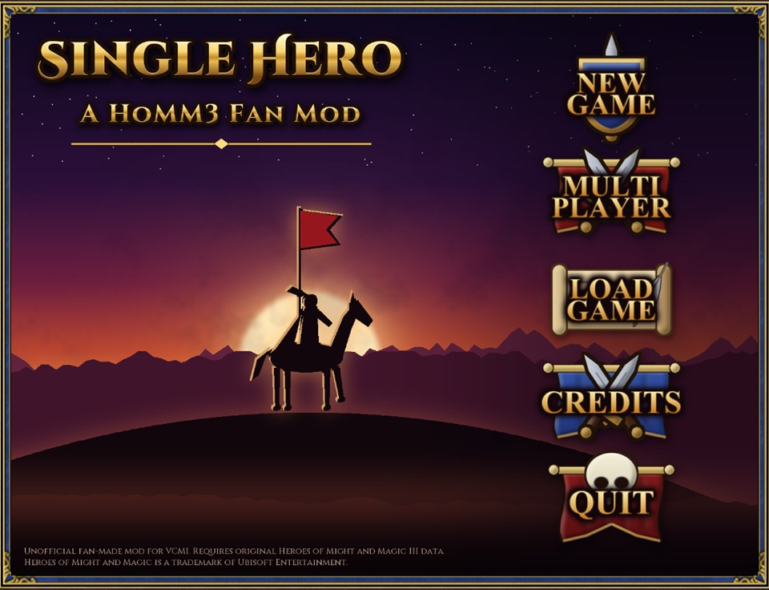
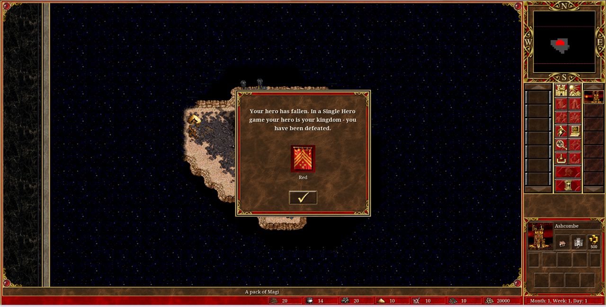
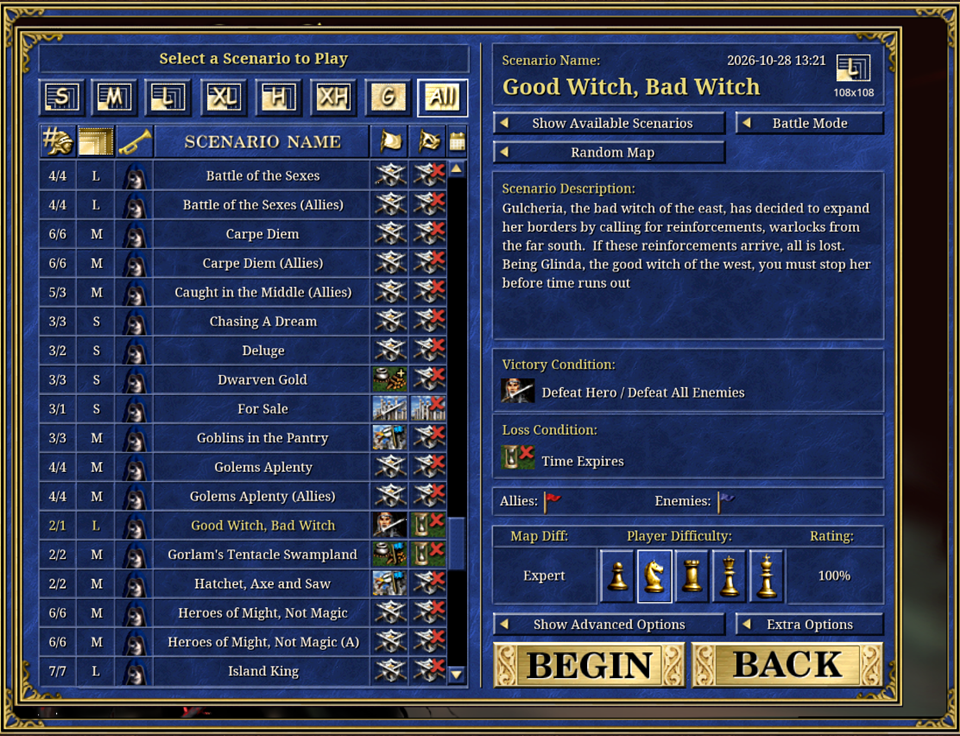
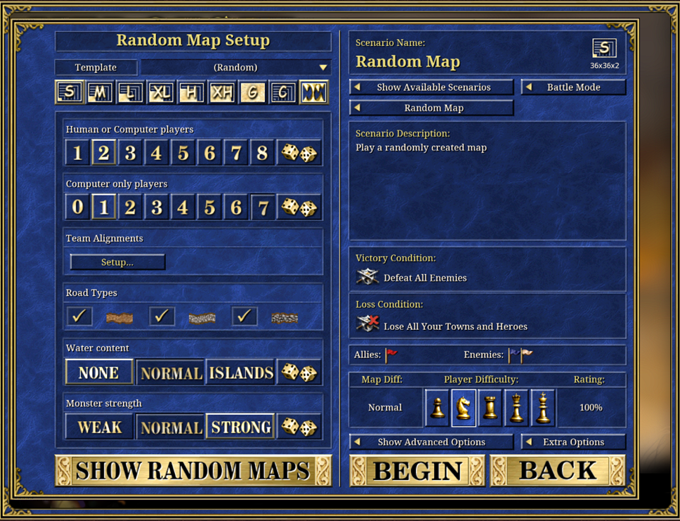
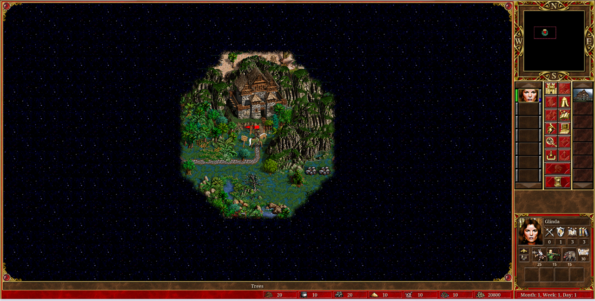
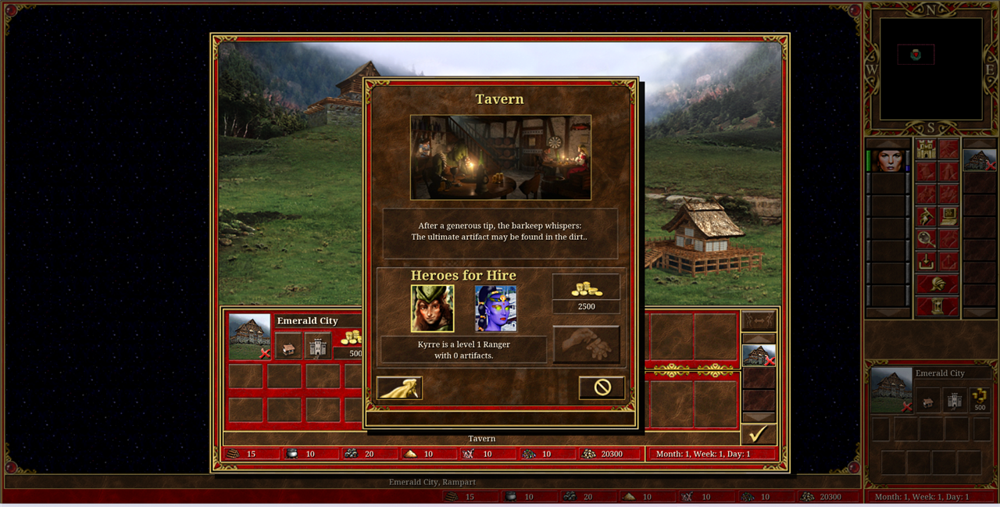
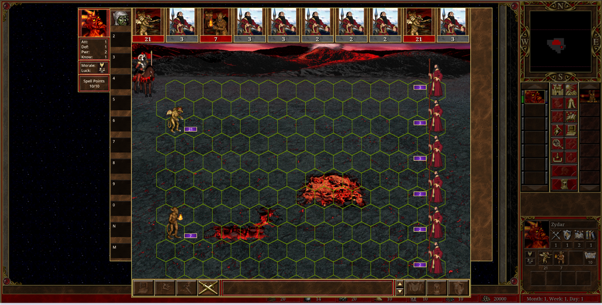
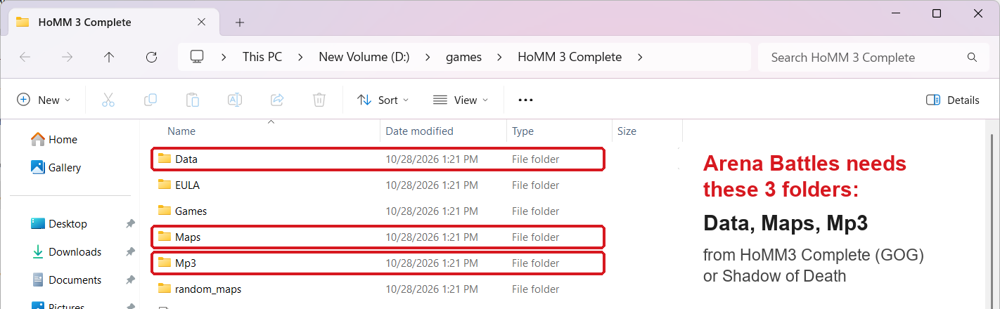

# Single Hero: A HoMM3 Fan Mod

**One hero. One life.** Single Hero is a fan-made game mode for *Heroes of Might and Magic III*, built on the open-source [VCMI](https://vcmi.eu/) engine and inspired by the *Single Hero* mode of *Heroes of Might and Magic: Olden Era*. Every player gets exactly one hero for the whole game, with no hero chains and no army couriers. If your hero falls, you lose, even if you still hold every town.

**⬇️ [Download the latest release](https://github.com/tishonator/single-hero-hmm3-fan-mod/releases/latest)** for Windows, macOS, Linux and Android.

> [!CAUTION]
> **You need your own copy of *Heroes of Might and Magic III: Complete* or *Shadow of Death*.**
> **The Steam *HD Edition* on its own will NOT work.** Single Hero contains no original game files.
> The easiest option is *HoMM3 Complete* from [GOG](https://www.gog.com/game/heroes_of_might_and_magic_3_complete_edition). See [how to use your game files](#1-before-you-start-the-original-game-data) **before you download**.



> **Made by [Tihomir Ivanov](#about-the-author) – [TishGamer on YouTube](https://www.youtube.com/@TishGamer).**
> If you like the mod, **[subscribe to the channel](https://www.youtube.com/@TishGamer?sub_confirmation=1)**. It's the best way to support the work.

---

## Contents

- [The rules](#the-rules)
  - [Hand-made maps](#hand-made-maps)
- [How it compares to Olden Era](#how-it-compares-to-olden-era)
- [Tips](#tips)
- [Screenshots](#screenshots)
- [Installation](#installation)
- [Building from source](#building-from-source)
- [How it works in VCMI](#how-it-works-in-vcmi)
- [Repository layout](#repository-layout)
- [About the author](#about-the-author)
- [Support my work](#support-my-work)
- [Credits and license](#credits-and-license)

## The rules

| Rule | What it means in the game |
| --- | --- |
| **One hero per player** | Every player starts with one hero. The tavern won't hire a second one, and prisons can't free one. The same rules apply to the computer players. |
| **Your hero is your life** | If your hero is **killed, retreats or surrenders**, you are **defeated** on the spot, even with towns left. |
| **No dismissing** | You can't dismiss your only hero. |
| **Any map** | Play any hand-made scenario (including the original HoMM3 maps) or a random map. When the game starts, every player keeps **one** hero. See [Hand-made maps](#hand-made-maps). |
| **Everything else is HoMM3** | Towns, creatures, spells, artifacts, the AI, hotseat and online multiplayer all work as usual. |

The **main menu** has *New Game*, *Multiplayer* (hotseat, LAN or online), *Load Game*, *Credits* and *Quit*.



### Hand-made maps

Hand-made scenarios often give a player several heroes at the start, or only towns. When the game starts, Single Hero fixes this for every player, human or computer:

- **Several heroes:** the player keeps one and the others leave the map. The one kept is chosen in this order:
  1. a hero that the map's victory or loss conditions name (such as *"Lose Jared Haret"* or *"Defeat Lord Haart"*);
  2. the starting hero you picked in the scenario options;
  3. the most experienced hero.
- **Towns but no hero:** the player gets a starting hero in their main town, using the hero picked in the scenario options if one was chosen.
- **The map's own victory and loss conditions still apply**, on top of the Single Hero rule. A hero that a condition names is always kept, even when that leaves a player with two heroes (very rare).

## How it compares to Olden Era

*Olden Era* has three modes: Classic, **Single Hero** and Arena. The developers describe Single Hero simply: the player has only one hero, and the hero's death means defeat. The pace is slower but the stakes are higher. Single Hero templates have no tavern.

| | Olden Era: Single Hero | This mod |
| --- | --- | --- |
| Heroes per player | 1 | 1 |
| Hero lost = game lost | Yes | Yes (killed, retreated or surrendered) |
| Tavern | Banned on single-hero templates | Can't hire: the hero limit is 1 |
| Maps | Templates made for one hero | Any hand-made scenario or VCMI random map template |
| Faster travel | Town portal and travel spells easier to get on some templates | Not yet (see the roadmap) |

**Roadmap ideas:** templates tuned for one hero (more dwellings and easier travel), a choice of the starting hero, an option to let the hero escape once, and an AI that plays its only hero more carefully.

## Tips

- **Never fight a battle you might lose.** Retreating or surrendering ends the game too, so check the enemy army first (right-click it, or use a View Air/Earth spell).
- **Your army must travel with you.** Nobody can carry new troops from your towns to the front. Plan your route back home for weekly recruits, or use Town Portal.
- **Logistics, Pathfinding and Wisdom matter more than ever.** Your one hero has to do everything.
- **Winning with only summoned creatures left still loses the hero**, as in classic HoMM3. Keep at least one real stack alive.

## Screenshots

| | |
| --- | --- |
|  **Play any hand-made scenario** |  **Or generate a random map** |
|  **One hero in your hero list** |  **The tavern can't hire a second hero** |
|  **Every battle puts your kingdom at stake** |  **Retreat or die, and the game is over** |

---

## Installation

Single Hero is a **standalone app**. It ships as its own build of the VCMI engine, with the mod built in and turned on automatically. It installs **next to** an official VCMI install and doesn't replace it.

### 1. Before you start: the original game data

> [!CAUTION]
> **Single Hero does not include any Heroes of Might and Magic III files. You need your own legal copy of *HoMM3 Complete* or *Shadow of Death*.**
> **The Steam *HD Edition* on its own will NOT work.**

You only need three folders of your installed game: **`Data`**, **`Maps`** and **`Mp3`**:



On first start, the setup wizard asks for them:

- **Windows, macOS, Linux:** point the wizard at your HoMM3 install folder, or give it the GOG **offline installer** (`setup_heroes_of_might_and_magic_3_complete_*.exe`) and it unpacks the files for you.
- **Android and iOS:** copy the GOG offline installer files (or the `Data`, `Maps` and `Mp3` folders from a PC) to your device, then select them in the setup wizard.

If you already play VCMI on this computer, Single Hero finds your data automatically.

### 2. Download

Open the **[latest release](https://github.com/tishonator/single-hero-hmm3-fan-mod/releases/latest)** and download the file for your system:

| System | File |
| --- | --- |
| Windows 10/11 | `SingleHero-<version>-x64.exe` (installer) or `.zip` (portable). Also `-x86` and `-arm64` |
| macOS | `SingleHero-<version>-arm.dmg` (Apple Silicon) or `-intel.dmg` |
| Linux | `SingleHero-<version>-x86_64.AppImage` |
| Android 5.0+ | `SingleHero-<version>-arm64-v8a.apk` |
| iOS / iPadOS | `SingleHero-<version>.ipa` (sideload with AltStore or Sideloadly) |

- **Windows:** SmartScreen may warn about the unsigned installer. Click **More info → Run anyway**, then start **VCMI Single Hero**.
- **macOS:** the app isn't notarized. Right-click → **Open** the first time. If macOS says it is "damaged", run `xattr -cr "/Applications/<app name>.app"`.
- **Linux:** run `chmod +x SingleHero-*.AppImage`, then start it. Some distributions also need `libfuse2`.
- **Android:** allow installing from unknown sources. The app is called **Single Hero** and installs next to the official VCMI app.

### 3. First launch

1. The launcher opens. If it doesn't find your HoMM3 data, its setup wizard asks for it.
2. **Single Hero is already built in and enabled.** You don't need to install or enable anything.
3. Press **Start game**, then choose **New Game**. Pick a scenario from the list, or press *Random Map* to generate one, and play.

### Troubleshooting

| Problem | Fix |
| --- | --- |
| "Heroes III data files are missing" | Run the setup wizard again (*Settings → Run setup wizard*) and point it at a *Complete* or *SoD* install. |
| The normal VCMI menu appears | You started the official VCMI. Use the **VCMI Single Hero** shortcut. |
| Something else went wrong | Open an [issue](https://github.com/tishonator/single-hero-hmm3-fan-mod/issues) and attach `VCMI_Client_log.txt` from the `logs` folder in the VCMI user folder (`Documents\My Games\vcmi` on Windows). |

---

## Building from source

This repository is a fork of [VCMI](https://github.com/vcmi/vcmi), based on the **1.7.5** release. Build it the same way you build VCMI:
[Windows](https://vcmi.eu/developers/Building_Windows/) ·
[macOS](https://vcmi.eu/developers/Building_macOS/) ·
[Linux](https://vcmi.eu/developers/Building_Linux/) ·
[Android](https://vcmi.eu/developers/Building_Android/) ·
[iOS](https://vcmi.eu/developers/Building_iOS/)

The `Mods/singlehero` folder is installed with the engine automatically.

**Automatic builds (GitHub Actions)**

- Every push to `main` builds packages for **all platforms**. They appear under the run's **Artifacts**.
- **Making a release:** push the commit to `main`, then push a version tag. CI builds everything and publishes the GitHub Release with all packages attached:
  ```sh
  git push origin main
  git tag v0.1.0
  git push origin v0.1.0
  ```
- If one platform fails, the release is still published with the others. **Re-run failed jobs** adds the missing files to the same release.

**Before you commit,** run the checks of the CI job *Validate Code* (line endings, JSON, Markdown) on exactly what would be committed. Needs Git Bash (or any Bash), Python 3 with `jstyleson`, and Node.js:

```sh
pip install jstyleson
bash single-hero/tools/validate.sh    # ends with "ALL CHECKS PASSED"
```

**The menu art** is original and drawn by scripts, with no pixels from the original game. To regenerate it (needs Python 3 and Pillow):

```sh
pip install pillow
python single-hero/tools/build_assets.py    # background and title
python single-hero/tools/build_buttons.py   # main menu buttons
python single-hero/tools/preview.py         # optional: renders single-hero/preview.png
```

## How it works in VCMI

Most of the mode is plain VCMI configuration. The mod's `mod.json` sets three game settings:

```json
"settings" : {
	"heroes" : {
		"perPlayerOnMapCap" : 1,
		"perPlayerTotalCap" : 1,
		"defeatOnHeroLoss" : true
	}
}
```

- `perPlayerOnMapCap` and `perPlayerTotalCap` are standard VCMI settings. They stop the tavern, prisons and the AI from adding a second hero.
- `defeatOnHeroLoss` is **new in this fork**:
  - `lib/gameState/CGameState.cpp`: a player with no hero is defeated, with its own defeat message;
  - `server/NetPacksServer.cpp`: the only hero can't be dismissed;
  - `lib/gameState/CGameState.cpp` (`initSingleHeroes`): at game start, every player is left with exactly one hero (see [Hand-made maps](#hand-made-maps)).

  It is off by default, so the engine behaves exactly like VCMI without the mod. It is small enough to propose upstream.

## Repository layout

| Path | What's inside |
| --- | --- |
| `Mods/singlehero/` | **The mod:** `mod.json` (rules), main menu layout, texts (`Content/config/singlehero/english.json`) and graphics |
| `lib/`, `server/`, `client/` | Small engine hooks for the `defeatOnHeroLoss` setting, the one-hero setup at game start and the credits (search for `Single Hero`) |
| `lib/modding/ModManager.cpp` | Keeps the Single Hero mod enabled in this build |
| `single-hero/tools/` | Scripts that generate the menu art, plus fonts (SIL Open Font License) |
| `single-hero/screenshots/` | Images used in this README |
| `CI/`, `.github/workflows/` | Build and release pipeline for all platforms |
| everything else | The VCMI engine (see `AUTHORS.h`, `ChangeLog.md`) |

---

## About the author

Hi! I'm **Tihomir Ivanov**, a software developer and a lifelong *Heroes of Might and Magic* fan. I make gaming videos on my YouTube channel **[TishGamer](https://www.youtube.com/@TishGamer)** and build free, open-source projects on GitHub as **[tishonator](https://github.com/tishonator)**. Also try my other mod, **[Arena Battles](https://github.com/tishonator/arena-battles-hmm3-fan-mod)**: draft a hero and army, then fight one battle.

- **YouTube:** [youtube.com/@TishGamer](https://www.youtube.com/@TishGamer)
- **GitHub:** [github.com/tishonator](https://github.com/tishonator)

## Support my work

Single Hero is **free**, and it will stay free. If you enjoy it:

1. **[Subscribe to TishGamer on YouTube](https://www.youtube.com/@TishGamer?sub_confirmation=1)** and turn on the 🔔.
2. **Share the mod** with friends and on your favourite HoMM3 forum or Discord.
3. **Star this repository** ⭐ on GitHub.
4. **Report bugs and ideas** in [Issues](https://github.com/tishonator/single-hero-hmm3-fan-mod/issues).
5. **Donate.** Any amount is greatly appreciated:

   [](https://www.paypal.com/donate/?hosted_button_id=S88TKD55YVK7S)

---

## Credits and license

- **Mod design, code and art:** Tihomir Ivanov ([TishGamer](https://www.youtube.com/@TishGamer)).
- **Idea:** the Single Hero mode of *Heroes of Might and Magic: Olden Era* by Unfrozen. This mod is not affiliated with it.
- **Engine:** [VCMI](https://vcmi.eu/) by the VCMI Team and contributors, licensed under the **GNU GPL v2 or later**. This fork, including all Single Hero changes, is released under the same license (see `license.txt`).
- **Fonts:** Cinzel, under the SIL Open Font License (see `single-hero/tools/fonts/`).
- **Heroes of Might and Magic** is a trademark of Ubisoft Entertainment. This is an **unofficial, non-commercial fan project**, not made, endorsed or supported by Ubisoft, Unfrozen or the VCMI Team. It doesn't include any of the original game's files.
